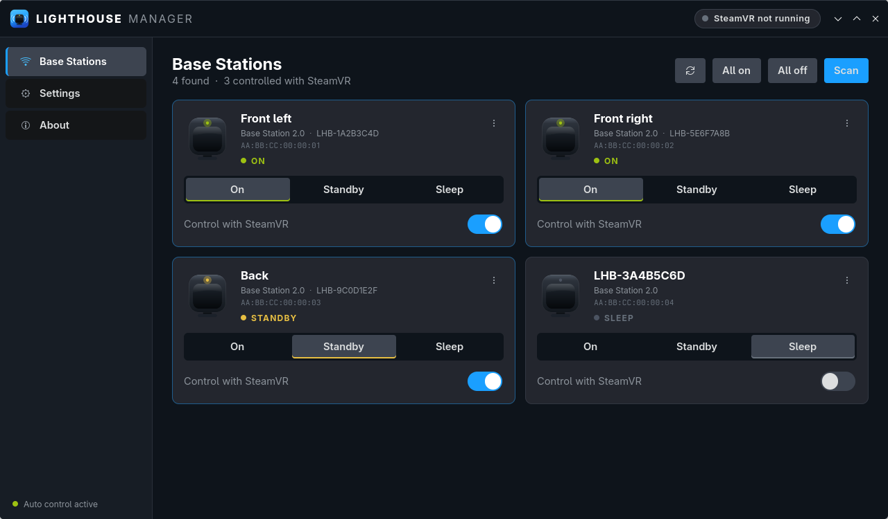
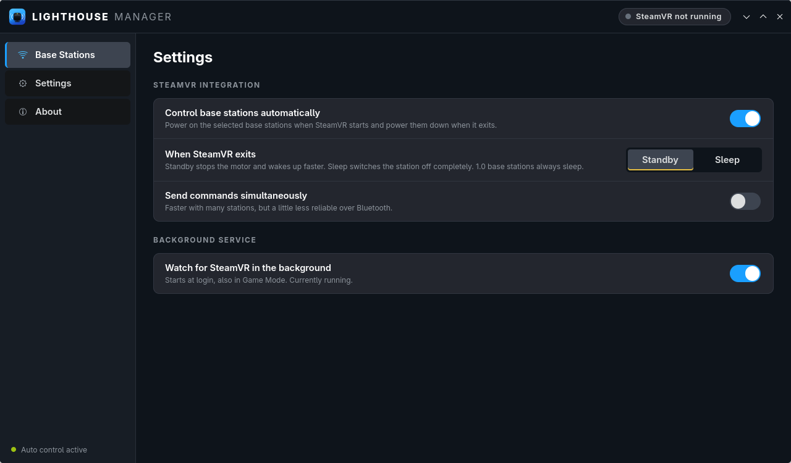

# OVR Lighthouse Manager-Linux

A Linux tool for turning your SteamVR base stations on and off. It does this automatically when SteamVR starts and stops.

It's a native Linux port of [kurotu's OVR Lighthouse Manager](https://github.com/kurotu/OVR-Lighthouse-Manager).
It's useful when you use a headset without Lighthouse tracking (Steam Frame, Quest, PICO, …) together with
trackers that need base stations. Supports **Base Station 1.0 and 2.0**.



## Features

- Power base stations on, to standby or to sleep over Bluetooth LE. They can also blink their LED so you can tell which one is which.
- A **background service** turns the selected stations on when SteamVR starts and powers them down when it exits.
  It runs in Game Mode and in Desktop Mode.
- If a station can't be reached when SteamVR exits (out of range, interference, the machine went to sleep), the service
  **tries again later in the background**: after 1, 2 and 5 minutes, then every 10 minutes for up to 6 hours, as long as SteamVR stays closed.
- A GTK4 app styled after SteamVR, plus a CLI.
- No extra dependencies on SteamOS. It uses the system Python with `dbus-python` and `PyGObject` and talks to BlueZ directly.
  The read-only root filesystem isn't touched.

The Windows original uses WinUI 3 and the WinRT Bluetooth APIs, so it can't be built for Linux. This port uses the same
BLE protocol (UUIDs and commands come from the original project).

## Install

```sh
git clone https://github.com/Inazumanotenshi/OVR-Lighthouse-Manager-Linux
cd OVR-Lighthouse-Manager-Linux
./install.sh
```

Everything goes into `~/.local`. The installer adds an app-menu entry with an icon and enables the
`ovr-lighthouse-manager` systemd **user** service. No root is needed.

Uninstall with `./uninstall.sh`. Your settings in `~/.config/ovr-lighthouse-manager/` are kept.

### Requirements

SteamOS already has everything. On other distributions you need:

| | Arch | Debian / Ubuntu |
|---|---|---|
| Python 3.10+ | `python` | `python3` |
| D-Bus bindings | `python-dbus` | `python3-dbus` |
| GTK4 bindings (only for the app) | `python-gobject`, `gtk4` | `python3-gi`, `gir1.2-gtk-4.0` |
| Bluetooth | `bluez` | `bluez` |
| PNG icons (optional) | `librsvg` | `librsvg2-bin` |

It's pure Python, so it isn't tied to one CPU architecture (x86_64 / ARM). It has only been tested on x86_64 so far.

## Setup

1. Open **OVR Lighthouse Manager** from the app menu. It scans for base stations on first start.
2. Turn on **Control with SteamVR** for every station that should follow SteamVR.
3. Under **Settings**, choose what happens when SteamVR exits: *Standby* (wakes up faster) or *Sleep* (fully off).

That's all. Start SteamVR and the stations power on. Quit it and they power down.

**Base Station 1.0:** open the card's `⋮` menu → *Set ID / rename…* and enter the 8-character ID printed on the back.



## CLI

```
ovr-lighthouse-manager scan            # find & remember stations
ovr-lighthouse-manager list
ovr-lighthouse-manager manage          # control all with SteamVR (or pass names / MACs)
ovr-lighthouse-manager on | off | sleep | standby | identify | status [names…] [--all]
ovr-lighthouse-manager config --power-down sleep --simultaneous on
ovr-lighthouse-manager set-id "HTC BS 123456" ABCD1234
ovr-lighthouse-manager rename LHB-1A2B3C4D "Front left"
ovr-lighthouse-manager daemon          # what the service runs
```

Logs: `journalctl --user -u ovr-lighthouse-manager -f`

## How it works / notes

- SteamVR is detected by its `vrserver` process. When SteamVR restarts, `vrserver` disappears for a moment, so the
  service waits about 6 s before powering down. A restart doesn't turn the stations off.
- **BLE connection strategy:** BlueZ discovery is kept running *while* connecting. Stopping discovery first connects
  faster, but in testing a single stuck connection then blocked the controller, and every following attempt hung
  for 30 s or more. With discovery running, each connection takes about 10–13 s (the kernel connects at the end of its
  scan cycle), but it never got stuck. Expect about 25–45 s for four stations one after another.
- `le-connection-abort-by-local` warnings in the log are normal. Each command is retried for up to 90 s per station.

## Credits & license

Based on [OVR Lighthouse Manager](https://github.com/kurotu/OVR-Lighthouse-Manager) by kurotu.
Licensed under [GPLv3](LICENSE), like the original.
